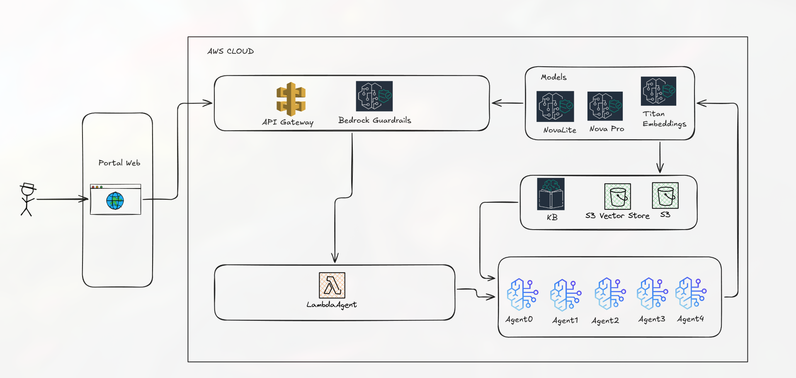

# Orquestador de onboarding digital bancario

Laboratorio de un **agente orquestador** que coordina agentes especializados durante el onboarding de un nuevo cliente bancario: verifica identidad, consulta listas de riesgo, prepara la documentación según las políticas del banco y redacta la respuesta al cliente. El orquestador controla qué herramientas puede usar cada agente, mantiene el estado entre pasos y mitiga la incertidumbre (fallos de herramientas, resultados ambiguos).

> **Todos los datos son ficticios.** Las tres herramientas son *mocks* deterministas y "Banco Demo" no existe. No ingreses datos personales reales.

- **Región AWS:** `us-east-2` (única permitida en este proyecto).
- **Estado del despliegue:** activo mientras no se ejecute `cdk destroy` (ver [Limpieza](#12-costos-y-limpieza)).
- **Pruebas locales:** 106 tests, sin necesidad de AWS.

---

## Índice

1. [Prueba rápida (5 minutos)](#1-prueba-rápida-5-minutos)
2. [Datos de prueba](#2-datos-de-prueba)
3. [Probar la API](#3-probar-la-api)
4. [Ver lo que el cliente no ve (auditoría interna)](#4-ver-lo-que-el-cliente-no-ve-auditoría-interna)
5. [Pruebas locales sin AWS](#5-pruebas-locales-sin-aws)
6. [Cómo se cumplen los requisitos](#6-cómo-se-cumplen-los-requisitos)
7. [Arquitectura](#7-arquitectura)
8. [Reglas de decisión](#8-reglas-de-decisión)
9. [Seguridad y privacidad](#9-seguridad-y-privacidad)
10. [Decisiones de diseño y desviaciones](#10-decisiones-de-diseño-y-desviaciones)
11. [Limitaciones conocidas](#11-limitaciones-conocidas)
12. [Costos y limpieza](#12-costos-y-limpieza)
13. [Despliegue desde cero](#13-despliegue-desde-cero)
14. [Estructura del repositorio](#14-estructura-del-repositorio)
15. [Recursos desplegados](#15-recursos-desplegados)

---

## 1. Prueba rápida (5 minutos)

La vía más corta, sin instalar nada: el portal web.

1. Abre **https://d19gf6de7d2kbb.cloudfront.net**
2. Despliega **"Casos de demostración (laboratorio)"** y pulsa un caso. Rellena la cédula y, si está vacío, el nombre con `Juan Perez`.
3. Pulsa **Solicitar**.
4. Compara el resultado con la tabla de la [sección 2](#2-datos-de-prueba).

Para el caso mínimo del enunciado, escribe a mano:

| Campo | Valor |
|---|---|
| Nombre completo | `Juan Perez` |
| Cédula de identidad | `1712345678` |
| Producto | Cuenta de ahorros |

Resultado esperado: **"Solicitud aprobada preliminarmente"** con 3 documentos requeridos.

> Si la URL no responde, el stack fue destruido. Mira [Despliegue desde cero](#13-despliegue-desde-cero) o ejecuta solo las [pruebas locales](#5-pruebas-locales-sin-aws).

---

## 2. Datos de prueba

### 2.1 Cómo se controlan los escenarios

Las herramientas mock deciden su respuesta por la **cédula** (`document_id`), siempre con 10 dígitos:

| Regla (se evalúa en este orden) | Herramienta | Efecto |
|---|---|---|
| Empieza con `99` | `verify_identity` | Timeout |
| Termina en `9` | `verify_identity` | `verified: false`, confianza 0.97 |
| Termina en `7` | `verify_identity` | `verified: true`, confianza **0.65** (ambigua) |
| Cualquier otra | `verify_identity` | `verified: true`, confianza 0.93 |
| Empieza con `98` | `check_risk_lists` | Timeout |
| Termina en `6` | `check_risk_lists` | Riesgo **high**, con una coincidencia |
| Empieza con `96` | `check_risk_lists` | Riesgo **medium**, con una coincidencia |
| Cualquier otra | `check_risk_lists` | Riesgo **low**, sin coincidencias |

`prepare_documentation` es determinista por producto (ver [2.4](#24-documentos-por-producto)).

### 2.2 Escenarios individuales

Usa nombre `Juan Perez` y producto `cuenta_ahorros`.

| Cédula | Escenario | Decisión | Qué ve el cliente |
|---|---|---|---|
| `1712345678` | Caso feliz (el del enunciado) | `APROBADO` | Aprobación preliminar y 3 documentos |
| `1712345677` | Confianza de identidad 0.65 (< 0.8) | `ESCALADO` | "Revisión adicional… 48 horas hábiles" |
| `1712345679` | Identidad no verificada (confianza alta) | `RECHAZADO` | "No pudimos continuar en línea… acércate a una agencia" |
| `1712345676` | Riesgo **high** | `ESCALADO` | Idéntico al de identidad ambigua |
| `9612345678` | Riesgo **medium** | `REQUIERE_INFO` | 5 documentos (3 base + 2 de debida diligencia reforzada) |
| `9812345678` | Timeout de la consulta de riesgo | `REQUIERE_INFO` | Pide información adicional |
| `9912345678` | Timeout de la verificación de identidad | `REQUIERE_INFO` | Pide información adicional |

Observa que **`1712345677` (identidad) y `1712345676` (riesgo alto) producen el mismo mensaje al cliente**. Es intencional: ver [tipping-off](#9-seguridad-y-privacidad).

### 2.3 Casos combinados (prueban la prioridad entre hallazgos)

Gana siempre el hallazgo más restrictivo. Las razones completas solo se ven en la [auditoría interna](#4-ver-lo-que-el-cliente-no-ve-auditoría-interna).

| Cédula | Hallazgos | Decisión final |
|---|---|---|
| `9612345679` | identidad no verificada + riesgo medium | `RECHAZADO` |
| `9812345679` | identidad no verificada + timeout de riesgo | `RECHAZADO` |
| `9912345676` | timeout de identidad + riesgo high | `ESCALADO` |

### 2.4 Documentos por producto

| Producto (`product`) | Documentos |
|---|---|
| `cuenta_ahorros` | Cédula (copia) · Planilla de servicio básico (máx. 3 meses) · Formulario de apertura firmado |
| `cuenta_corriente` | Los 3 anteriores + Referencias bancarias o comerciales + RUC o declaración de ingresos |
| `tarjeta_credito` | Los 3 primeros + Rol de pagos o certificado de ingresos + Autorización de consulta a buró de crédito |

Con riesgo **medium** se agregan siempre: *Declaración de origen de fondos* y *Certificado de actividad económica*.

Solo `APROBADO` y `REQUIERE_INFO` devuelven documentos. Con `ESCALADO` y `RECHAZADO` la lista va vacía.

### 2.5 Entradas inválidas (deben dar 422)

| Entrada | Motivo |
|---|---|
| `document_id`: `123`, `171234567`, `17123456ab` | Debe tener exactamente 10 dígitos |
| `product`: `hipoteca` | Solo `cuenta_ahorros`, `cuenta_corriente`, `tarjeta_credito` |
| `prospect_name`: `""` o `Juan; DROP 1` o con saltos de línea | Solo letras, espacios, `'`, `.` y `-`. El nombre entra a un prompt de LLM, por eso no admite texto libre |

La respuesta 422 indica **campo y tipo de error, nunca el valor recibido**, para no devolver PII.

---

## 3. Probar la API

### 3.1 Vía CloudFront (sin API key)

CloudFront inyecta la key hacia API Gateway; el navegador y `curl` no la necesitan.

```bash
curl -s -X POST https://d19gf6de7d2kbb.cloudfront.net/api/v1/onboarding/start \
  -H 'Content-Type: application/json' \
  -d '{"prospect_name":"Juan Perez","document_id":"1712345678","product":"cuenta_ahorros"}'
```

Respuesta (el texto exacto de `customer_message` varía, lo redacta Nova Lite):

```json
{
  "onboarding_id": "2b0e6a52-…",
  "decision": "APROBADO",
  "customer_message": "Hola Juan, tu solicitud de cuenta de ahorros ha sido aprobada preliminarmente. …",
  "required_documents": [
    "Cédula de identidad (copia)",
    "Planilla de servicio básico (máximo 3 meses)",
    "Formulario de apertura firmado"
  ]
}
```

Contrato de la respuesta al cliente: **solo** esos cuatro campos. No hay motivos, ni nivel de riesgo, ni tickets.

Barrido de todos los escenarios:

```bash
URL=https://d19gf6de7d2kbb.cloudfront.net/api/v1/onboarding/start
for ID in 1712345678 1712345677 1712345679 1712345676 9612345678 9812345678 9912345678; do
  printf "%s -> " $ID
  curl -s -X POST $URL -H 'Content-Type: application/json' \
    -d "{\"prospect_name\":\"Juan Perez\",\"document_id\":\"$ID\",\"product\":\"cuenta_ahorros\"}" \
    | python3 -c 'import sys,json; print(json.load(sys.stdin)["decision"])'
done
```

Salida esperada, en orden: `APROBADO`, `ESCALADO`, `RECHAZADO`, `ESCALADO`, `REQUIERE_INFO`, `REQUIERE_INFO`, `REQUIERE_INFO`.

### 3.2 Directo a API Gateway (con API key)

```bash
API=https://gighsestv3.execute-api.us-east-2.amazonaws.com/prod/api/v1/onboarding/start
KEY=$(aws apigateway get-api-key --api-key t91y344xh2 --include-value \
      --region us-east-2 --query value --output text)

curl -s -X POST "$API" -H "x-api-key: $KEY" -H 'Content-Type: application/json' \
  -d '{"prospect_name":"Juan Perez","document_id":"1712345678","product":"cuenta_ahorros"}'
```

### 3.3 Códigos de respuesta

| Código | Cuándo | Cómo provocarlo |
|---|---|---|
| 200 | Decisión tomada (incluye escalado y rechazo) | Cualquier caso de la sección 2 |
| 400 | Cuerpo no es JSON | `-d 'no-json'` |
| 422 | Campos inválidos | Ver [2.5](#25-entradas-inválidas-deben-dar-422) |
| 403 | Falta la API key (solo directo a API Gateway) | Omitir `x-api-key` en 3.2 |
| 429 | Límite de uso | Más de 5 req/s sostenidas o 500 llamadas/día |
| 500 | Error inesperado; mensaje genérico, sin detalles | No se provoca de forma normal |

Comprobaciones de seguridad rápidas:

```bash
# Directo, sin key o con key falsa: ambos 403
curl -s -o /dev/null -w "%{http_code}\n" -X POST "$API" -d '{}'
curl -s -o /dev/null -w "%{http_code}\n" -X POST "$API" -H 'x-api-key: FALSA' -d '{}'

# Por CloudFront, una key falsa del cliente se ignora (CloudFront la sobrescribe): 200
curl -s -o /dev/null -w "%{http_code}\n" -X POST \
  https://d19gf6de7d2kbb.cloudfront.net/api/v1/onboarding/start \
  -H 'x-api-key: FALSA' \
  -d '{"prospect_name":"Juan Perez","document_id":"1712345678","product":"cuenta_ahorros"}'
```

---

## 4. Ver lo que el cliente no ve (auditoría interna)

El **plan de mitigación**, las razones internas y el ticket de escalamiento **no salen en la API**. Quedan en el log de auditoría (CloudWatch Logs), con la cédula y el nombre enmascarados.

```bash
FN=$(aws lambda list-functions --region us-east-2 \
  --query "Functions[?starts_with(FunctionName,'OnboardingStack-OnboardingFunction')].FunctionName" --output text)
LG=$(aws lambda get-function-configuration --function-name "$FN" --region us-east-2 \
  --query LoggingConfig.LogGroup --output text)

# Decisiones con sus razones y el ticket de escalamiento
aws logs filter-log-events --region us-east-2 --log-group-name "$LG" \
  --filter-pattern '"decision_made"' --query 'events[].message' --output text

# Plan de mitigación propuesto (causas, acciones, responsable)
aws logs filter-log-events --region us-east-2 --log-group-name "$LG" \
  --filter-pattern '"mitigation_proposed"' --query 'events[].message' --output text
```

Cada onboarding deja una traza de eventos JSON con el mismo `onboarding_id`:
`onboarding_started` → `identity_checked` / `risk_checked` (o `tool_error`) → `documentation_prepared` → `decision_made` → `mitigation_proposed` → `message_drafted`.

Ejemplo de `decision_made` para `1712345678`:

```json
{"ts": "…", "onboarding_id": "…", "agent": "orchestrator", "event": "decision_made",
 "decision": "APROBADO", "reasons": ["ALL_CHECKS_PASSED"], "escalation_ticket": null}
```

Verifica que **no hay PII**: estas búsquedas deben devolver 0 eventos.

```bash
for t in 1712345678 1712345676 Perez PEP-MOCK ADVERSE-MEDIA; do
  printf "%s -> " $t
  aws logs filter-log-events --region us-east-2 --log-group-name "$LG" \
    --filter-pattern "\"$t\"" --query 'length(events)' --output text | tail -1
done
```

Y la cédula enmascarada (`171****678`) sí aparece.

Razones internas posibles: `ALL_CHECKS_PASSED`, `IDENTITY_NOT_VERIFIED`, `IDENTITY_AMBIGUOUS`, `IDENTITY_LOW_CONFIDENCE`, `IDENTITY_UNAVAILABLE`, `RISK_HIGH`, `RISK_MEDIUM`, `RISK_UNAVAILABLE`, `DOCUMENTATION_UNAVAILABLE`.

---

## 5. Pruebas locales sin AWS

Requisitos: [`uv`](https://docs.astral.sh/uv/) y Python ≥ 3.12.

```bash
uv sync
uv run pytest -q          # 106 passed
uv run python main.py     # demo de los 7 escenarios, con vista cliente e interna
```

`main.py` imprime, para cada escenario, la decisión, las razones internas, la primera línea del mensaje al cliente y el plan de mitigación (que en la API real nunca llega al cliente).

Tests por módulo:

| Archivo | Tests | Qué cubre |
|---|---|---|
| `tests/test_policy.py` | 15 | Matriz de decisión, umbral 0.8 inclusivo, prioridad, mitigación y ticket |
| `tests/test_tools.py` | 12 | Cada mock, y **permisos por agente** (un agente no puede llamar herramientas ajenas) |
| `tests/test_orchestrator.py` | 31 | Los 7 escenarios, fallos de herramientas, salida malformada, PII en logs, vista cliente |
| `tests/test_handler.py` | 10 | 200 / 400 / 422 / 500, sin eco de PII, sin datos internos |
| `tests/test_cloud.py` | 26 | Redactor LLM: parámetros, salvaguardas y respaldo a plantilla |
| `tests/test_policies.py` | 7 | Los documentos de políticas (KB) coinciden con el código |
| `tests/test_portal.py` | 5 | CSP: sin scripts/estilos inline, sin `innerHTML`, sin API key en el portal |

Los tests del redactor usan clientes falsos: **no llaman a AWS**.

---

## 6. Cómo se cumplen los requisitos

| Requisito del enunciado | Cómo se cumple | Dónde verificarlo |
|---|---|---|
| Agente orquestador que coordina agentes | `Orchestrator` con flujo fijo y 4 agentes | `onboarding/orchestrator.py`, `agents.py` |
| Controla qué herramientas usa cada agente | `ToolRegistry` con una lista blanca por agente; fuera de ella lanza `ToolPermissionError` | `onboarding/tools.py`, `test_tools.py` |
| Maneja el estado entre pasos | `OnboardingState` compartido por petición + traza de auditoría JSON | `onboarding/models.py`, `audit.py` |
| Mitiga la incertidumbre | Fallo o salida inválida de una herramienta ⇒ `REQUIERE_INFO` (no 500); plan de mitigación estructurado | `policy.py`, `test_orchestrator.py` |
| Recibe una solicitud con datos del prospecto | `POST /api/v1/onboarding/start` con `prospect_name`, `document_id`, `product` | `handler.py`, sección 3 |
| Determina si el cliente es apto según políticas | Matriz de decisión determinista (sección 8) | `policy.py`, `politica_debida_diligencia.md` |
| Si algo falla o es ambiguo, propone una solución | `mitigation`: causas, acciones, responsable y ticket simulado | Sección 4 |
| Tool 1 `verify_identity`; confianza < 0.8 escala | Mock + regla `IDENTITY_LOW_CONFIDENCE` | `tools.py`, cédula `…7` |
| Tool 2 `check_risk_lists`; `high` escala | Mock + regla `RISK_HIGH` | `tools.py`, cédula `…6` |
| Tool 3 `prepare_documentation` | Mock por producto | `tools.py`, sección 2.4 |

---

## 7. Arquitectura

### 7.1 Diagrama de referencia del laboratorio



*Fuente: [álbum original en Imgur](https://imgur.com/a/V3KHaJd). Copia local en `docs/arquitectura-referencia.png`.*

La implementación sigue este diagrama con las siguientes diferencias, todas deliberadas:

| En el diagrama | En la implementación | Motivo |
|---|---|---|
| Portal Web → API Gateway | Portal → **CloudFront** (S3 privado), que reenvía `/api/*` a API Gateway **e inyecta la API key** | Una página estática no puede guardar una key sin exponerla |
| Models: Nova Lite, **Nova Pro**, Titan | Solo **Nova Lite** y Titan Embeddings v2 | Nova Pro exige cross-Region inference, que este proyecto no permite |
| Bedrock Guardrails junto a API Gateway | El Guardrail se aplica **dentro del Lambda**, en la llamada `Converse` (entrada y salida) | API Gateway no invoca Guardrails por sí solo |
| LambdaAgent → Agent0…Agent4 como agentes | Agent0 es el orquestador dentro del Lambda; Agent1-4 son componentes de código, **no Bedrock Agents** | Bedrock Agents clásico está en modo mantenimiento y dejaría al LLM decidir el flujo |
| Agentes → Models | Solo **Agent4** invoca un modelo; Agent1-3 usan las herramientas mock | El LLM redacta, no decide |
| KB + S3 Vector Store + S3 | Igual: KB con S3 Vectors, y un bucket S3 con las 5 políticas | — |
| KB → Agentes | La KB se consulta desde el redactor (Agent4) para fundamentar el mensaje | Los documentos requeridos los entrega la herramienta mock |

### 7.2 Implementación desplegada

```
Usuario ─▶ CloudFront ──────────────▶ S3 privado (portal HTML/JS/CSS)
              │  /api/*  (inyecta x-api-key desde Secrets Manager)
              ▼
        API Gateway REST  ── API key + usage plan (5 req/s, 500/día)
              ▼
        Lambda "OnboardingFunction"  (Agent0: orquestador determinista)
              │
              ├─▶ Agent1  identidad      ── tool verify_identity       (mock)
              ├─▶ Agent2  riesgo         ── tool check_risk_lists      (mock)
              ├─▶ Agent3  documentación  ── tool prepare_documentation (mock)
              └─▶ Agent4  respuesta      ── sin tools; redacta con ─▶ Bedrock
                                                                      ├─ Nova Lite (Converse)
                                                                      ├─ Guardrail v1
                                                                      └─ Knowledge Base
                                                                           ├─ S3 (5 políticas .md)
                                                                           ├─ S3 Vectors (índice)
                                                                           └─ Titan Embeddings v2
```

### 7.3 Flujo de una solicitud

1. **Validación** del request (formato de cédula, nombre solo con letras, producto válido).
2. **Agent1** y **Agent2** corren **siempre ambos**: Cumplimiento quiere el panorama completo aunque uno falle.
3. El orquestador evalúa la matriz de decisión.
4. Si el resultado es `APROBADO` o `REQUIERE_INFO`, **Agent3** prepara los documentos. Si esa herramienta falla, la aprobación baja a `REQUIERE_INFO`.
5. Se construye el plan de mitigación (solo si no es `APROBADO`).
6. **Agent4** redacta el mensaje. Nova Lite **reescribe** una plantilla determinista; no decide nada.
7. Se devuelve **solo la vista del cliente**. La vista interna va al log.

### 7.4 Los agentes

| Agente | Responsabilidad | Herramienta permitida | ¿LLM? |
|---|---|---|---|
| Agent0 `orchestrator` | Flujo, estado, decisión, mitigación | ninguna | No |
| Agent1 `identity_agent` | Verificar identidad | `verify_identity` | No |
| Agent2 `risk_agent` | Consultar listas de riesgo | `check_risk_lists` | No |
| Agent3 `documentation_agent` | Documentos por producto y riesgo | `prepare_documentation` | No |
| Agent4 `response_agent` | Mensaje al cliente | ninguna | Sí (Nova Lite) |

El agente de respuesta **no tiene herramientas**, así que nunca ve datos de listas de riesgo.

### 7.5 Uso de la Knowledge Base

La KB (5 políticas en `policies/`) se consulta para **fundamentar el tono y los mensajes** del redactor (política de comunicación). Los documentos requeridos los entrega la herramienta mock, no la KB; un test (`test_policies.py`) garantiza que ambas fuentes no se desfasen.

---

## 8. Reglas de decisión

Gana el hallazgo más restrictivo: `RECHAZADO` > `ESCALADO` > `REQUIERE_INFO` > `APROBADO`.

| Hallazgo | Código interno | Decisión |
|---|---|---|
| Identidad no verificada, confianza ≥ 0.8 | `IDENTITY_NOT_VERIFIED` | `RECHAZADO` |
| Identidad no verificada, confianza < 0.8 | `IDENTITY_AMBIGUOUS` | `ESCALADO` |
| Identidad verificada, confianza < 0.8 | `IDENTITY_LOW_CONFIDENCE` | `ESCALADO` |
| Riesgo `high` | `RISK_HIGH` | `ESCALADO` (con ticket `ESC-XXXXXXXX`) |
| Riesgo `medium` | `RISK_MEDIUM` | `REQUIERE_INFO` (+ 2 documentos) |
| Falla la verificación de identidad | `IDENTITY_UNAVAILABLE` | `REQUIERE_INFO` |
| Falla la consulta de riesgo | `RISK_UNAVAILABLE` | `REQUIERE_INFO` |
| Falla la preparación de documentos | `DOCUMENTATION_UNAVAILABLE` | `REQUIERE_INFO` |
| Nada de lo anterior | `ALL_CHECKS_PASSED` | `APROBADO` |

El umbral es **0.8 inclusivo** (0.8 aprueba, 0.79 escala). Está documentado en `policies/politica_debida_diligencia.md` y un test verifica que coincida con el código.

---

## 9. Seguridad y privacidad

| Control | Detalle |
|---|---|
| **Sin tipping-off** | El cliente nunca ve coincidencias de listas, nivel de riesgo, códigos internos, tickets ni responsables. Identidad ambigua y riesgo alto devuelven el mismo mensaje. |
| **Vista cliente vs. interna** | Dos modelos separados (`OnboardingResponse` / `InternalReview`); un test fija los campos públicos. |
| **PII enmascarada** | Cédula (`171****678`) y nombre (`J*** P***`) en el log. Las coincidencias de listas no se registran, solo su cantidad. |
| **La cédula nunca va al LLM** | Al redactor solo llegan el primer nombre, la decisión, el producto y los documentos. |
| **Validación de entrada** | Nombre restringido a letras: evita inyección de prompt por el campo libre. |
| **Defensa en capas contra el LLM** | (1) Guardrail Bedrock en entrada y salida. (2) Validación propia del texto: debe incluir el nombre, todos los documentos y, según el caso, "48 horas hábiles" o "agencia"; se rechazan términos de riesgo y marcadores `[ ] { } < >`. (3) Si algo falla, se envía la **plantilla determinista**. |
| **Guardrail** | Versión numerada `1` (no `DRAFT`), `trace` deshabilitado, filtro de *prompt attack*, tema denegado de divulgación de listas, bloqueo de tarjetas, anonimizado de correo y teléfono. El nombre propio **no** se filtra: es el saludo. |
| **API** | API key obligatoria, 5 req/s, 500 llamadas/día. La key vive en Secrets Manager y la inyecta CloudFront; no está en el portal. |
| **Portal** | S3 privado (OAC), HTTPS obligatorio, CSP estricta, HSTS, `X-Frame-Options: DENY`, `nosniff`, sin `innerHTML`. |
| **Errores** | 422 sin eco de valores; 500 genérico sin detalles. |
| **Región** | Todo en `us-east-2`; Nova Lite on-demand, **sin** cross-Region inference. |

---

## 10. Decisiones de diseño y desviaciones

| Decisión | Motivo |
|---|---|
| **Orquestación determinista, LLM solo redacta** | Las reglas de un banco no pueden depender de un prompt. Es auditable, barata y testeable. |
| **Agentes como funciones, no Bedrock Agents** | Bedrock Agents clásico está en modo mantenimiento y cerrado a clientes nuevos; además el LLM decidiría el flujo. |
| **Solo Nova Lite (sin Nova Pro)** | Nova Pro exige cross-Region inference, que este proyecto no permite. Nova Lite es on-demand en la Región. |
| **KB customer-managed con S3 Vectors** | Es lo que muestra el diagrama ("S3 Vector Store"). |
| **Estado en memoria + auditoría JSON** | Pedido en el diseño; un Lambda no conserva memoria entre invocaciones, así que el estado vive durante la petición y la trazabilidad en CloudWatch. No hay `GET /onboarding/{id}`. |
| **CloudFront delante de la API** | Un portal estático no puede guardar una API key sin exponerla. |
| **Mocks por último dígito y prefijos** | Tests repetibles. `1712345678` (cédula del enunciado) es el caso feliz. |

**Desviaciones respecto a lo propuesto al inicio:**

- **Un solo rol IAM**, no uno por agente. Con un único Lambda no es posible. La separación de permisos entre agentes la impone `ToolRegistry` en código. Como las herramientas son mock, el rol del Lambda solo tiene permisos de Bedrock.
- **Riesgo `high` en el dígito 6**, no en el 8: `1712345678` debía ser el caso feliz.

---

## 11. Limitaciones conocidas

- **Las herramientas son mock.** No hay verificación de identidad ni listas de riesgo reales.
- **Sin persistencia ni consulta posterior** del onboarding; solo el log de auditoría.
- **Guardrail clásico:** el nivel Standard exige cross-Region inference. La cobertura del tema denegado en español no se validó a fondo; la validación propia del texto es el control principal.
- **El Guardrail no se re-versiona solo.** Si se cambia su configuración en CDK, hay que crear una nueva versión (cambiar el id lógico de `GuardrailVersion`) o el Lambda seguirá usando la `1`.
- **Sin WAF** ni autenticación de usuarios en el portal; el control de abuso es el límite del usage plan.
- **TLS:** el certificado `*.cloudfront.net` por defecto fija TLSv1 como mínimo. Un dominio propio con certificado lo corregiría.
- **Logs sin cifrado KMS**, con retención de 1 mes. No contienen PII en claro, pero un entorno regulado debería cifrarlos.
- **Latencia de 2 a 3 segundos** por solicitud (llamada a Nova Lite); dentro del límite de 29 s de API Gateway.
- **El texto del mensaje varía** entre ejecuciones (LLM). Los tests y las decisiones no dependen de él.

---

## 12. Costos y limpieza

La cuenta está en el **plan FREE** con crédito limitado. No se midió el costo real del laboratorio: revísalo en *AWS Billing and Cost Management*. Todo es serverless o de pago por uso; no hay recursos con cargo fijo alto. El tope de 500 llamadas/día limita el gasto en Bedrock.

Para **eliminar todo** (cuando termine la revisión):

```bash
cd infra
export CDK_DEFAULT_ACCOUNT=$(aws sts get-caller-identity --query Account --output text)
npx cdk destroy
```

- Los buckets se vacían y borran solos (`auto_delete_objects`).
- El stack `CDKToolkit` (bootstrap) **se conserva**: borrarlo rompe futuros despliegues de CDK.
- Comprueba que no queda nada:
  ```bash
  aws cloudformation describe-stacks --stack-name OnboardingStack --region us-east-2
  # debe responder "does not exist"
  ```
- CDK configura el rol de CloudWatch de API Gateway, un ajuste **a nivel de cuenta**. Revísalo si usas API Gateway en otros proyectos.

---

## 13. Despliegue desde cero

**Requisitos:** AWS CLI v2 con sesión activa (`aws login`), Node.js ≥ 20, `uv`, Python ≥ 3.12, cuenta con acceso a Bedrock (Nova Lite y Titan Embeddings v2) en `us-east-2`.

```bash
# 1. Dependencias y verificación de identidad AWS
uv sync
aws sts get-caller-identity

# 2. Empaquetar el Lambda (linux/arm64, py3.12) en build/lambda
./scripts/build_lambda.sh

# 3. CDK (el CLI queda fijado a una versión exacta en infra/package.json)
cd infra
npm ci
export CDK_DEFAULT_ACCOUNT=$(aws sts get-caller-identity --query Account --output text)
npx cdk bootstrap aws://$CDK_DEFAULT_ACCOUNT/us-east-2     # solo la primera vez
npx cdk synth --strict -q
npx cdk deploy --require-approval never --outputs-file outputs.json   # ~4 min (CloudFront)
```

**Paso obligatorio: ingestar las políticas en la KB.** El despliegue no lo hace; sin él, la KB está vacía.

```bash
KB=$(aws cloudformation describe-stacks --stack-name OnboardingStack --region us-east-2 \
  --query "Stacks[0].Outputs[?OutputKey=='KnowledgeBaseId'].OutputValue" --output text)
DS=$(aws cloudformation describe-stacks --stack-name OnboardingStack --region us-east-2 \
  --query "Stacks[0].Outputs[?OutputKey=='DataSourceId'].OutputValue" --output text)

JOB=$(aws bedrock-agent start-ingestion-job --knowledge-base-id $KB --data-source-id $DS \
  --region us-east-2 --query ingestionJob.ingestionJobId --output text)

aws bedrock-agent get-ingestion-job --knowledge-base-id $KB --data-source-id $DS \
  --ingestion-job-id $JOB --region us-east-2 \
  --query 'ingestionJob.{status:status,stats:statistics}'
# Espera status COMPLETE y numberOfNewDocumentsIndexed = 5
```

Comprobar la KB:

```bash
aws bedrock-agent-runtime retrieve --knowledge-base-id $KB --region us-east-2 \
  --retrieval-query '{"text":"documentos requeridos para tarjeta de crédito"}' \
  --query 'retrievalResults[].[score,location.s3Location.uri]' --output text
```

La primera línea debe apuntar a `politica_tarjeta_credito.md`.

Redespliegues: tras cambiar código en `onboarding/`, ejecuta de nuevo `./scripts/build_lambda.sh` y `npx cdk deploy`. Tras cambiar `portal/` o `policies/`, basta `npx cdk deploy` (esta última requiere volver a ingestar).

> Si el AWS CLI falla con `AWS_ERROR_CAL_UNSUPPORTED_KEY_FORMAT`, la caché de `aws login` quedó obsoleta: ejecuta `aws login` de nuevo.

---

## 14. Estructura del repositorio

```
onboarding/            Aplicación (código que corre en el Lambda)
  models.py              Pydantic: request, resultados de tools, decisión, vistas cliente/interna
  tools.py               3 tools mock + ToolRegistry (permisos por agente)
  policy.py              Matriz de decisión y plan de mitigación
  agents.py              Agent1-4 y plantilla determinista de mensajes
  orchestrator.py        Agent0: flujo, estado y auditoría
  audit.py               Log JSON y enmascarado de PII
  cloud.py               Redactor Bedrock (Nova Lite + Guardrail + KB) y salvaguardas
  handler.py             Entrypoint Lambda de POST /api/v1/onboarding/start
docs/                  Diagrama de arquitectura de referencia (PNG)
policies/              5 políticas ficticias (contenido de la KB)
portal/                Portal web (HTML, JS y CSS, sin dependencias)
infra/                 AWS CDK en Python (stack.py, app.py) y CLI de CDK fijado
scripts/build_lambda.sh  Empaqueta el Lambda para linux/arm64
tests/                 106 tests
main.py                Demo local de los 7 escenarios
```

---

## 15. Recursos desplegados

Valores al momento de la entrega; los vigentes se obtienen con `aws cloudformation describe-stacks --stack-name OnboardingStack --region us-east-2 --query 'Stacks[0].Outputs'`.

| Recurso | Valor |
|---|---|
| Región | `us-east-2` |
| Stack | `OnboardingStack` |
| Portal | https://d19gf6de7d2kbb.cloudfront.net |
| API | `https://gighsestv3.execute-api.us-east-2.amazonaws.com/prod/api/v1/onboarding/start` |
| API key (id) | `t91y344xh2` |
| Secreto de la key | `ApiKeySecretF1B08E61-cK0li1xc1YGf` |
| Knowledge Base | `HJJWCKZ1J1` (data source `JOM6MNOQXI`) |
| Guardrail | `v5ykr1yt7h1c`, versión `1` |
| Modelos | `amazon.nova-lite-v1:0`, `amazon.titan-embed-text-v2:0` |
| Lambda | Python 3.12, arm64, 512 MB, timeout 25 s |
